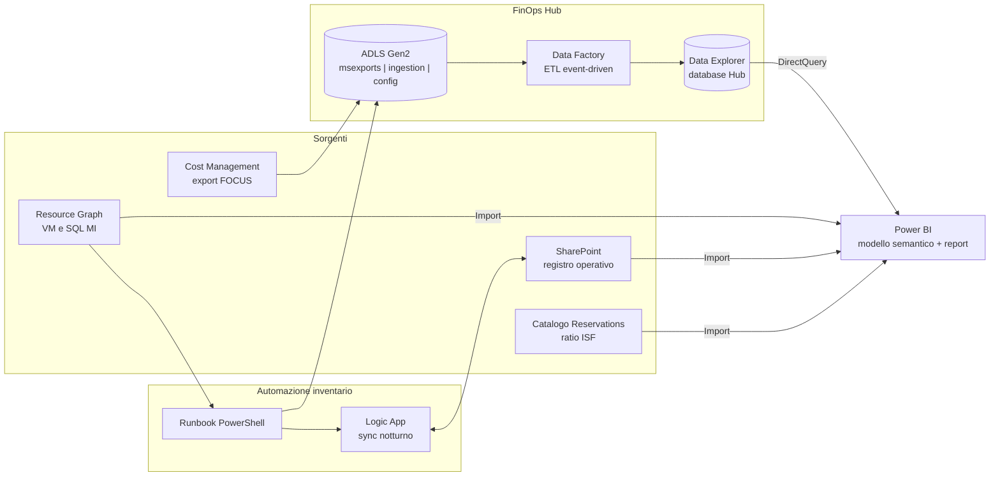
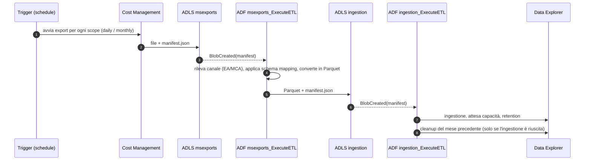
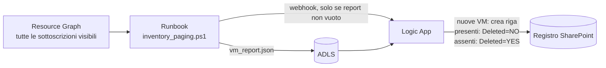
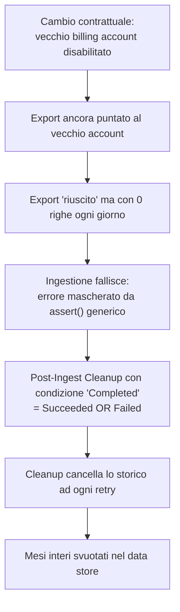
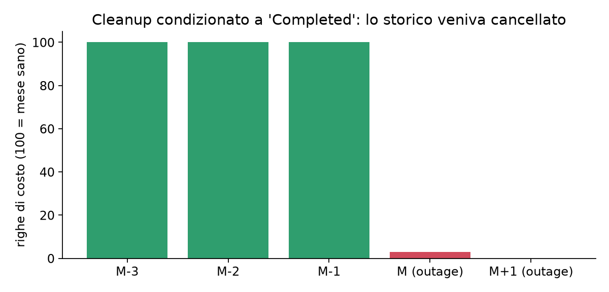
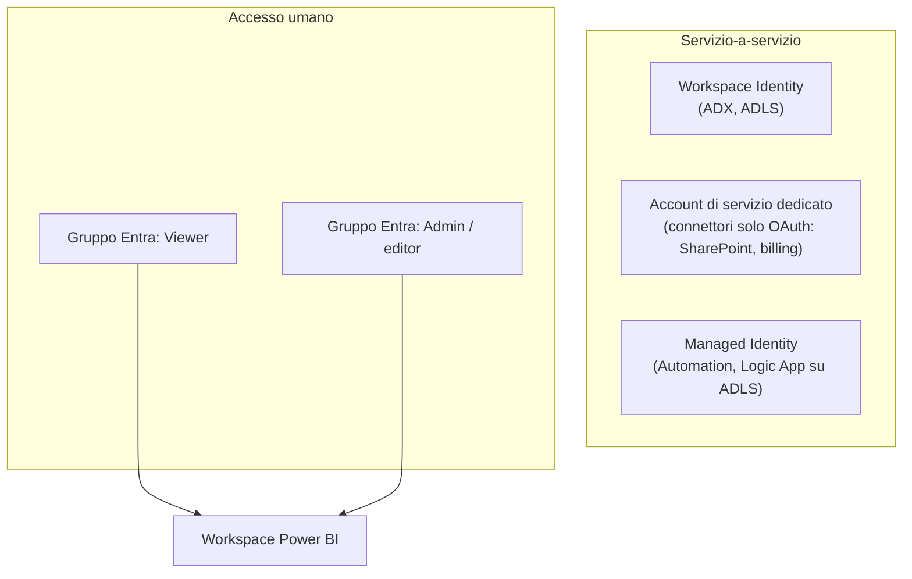

# FinOps Hub: piattaforma dati per la governance dei costi Azure

> Case study di una piattaforma **cloud-native di analisi dei costi Azure** basata sul
> [Microsoft FinOps Toolkit](https://microsoft.github.io/finops-toolkit/hubs), con un motore di raccomandazione per
> **Reserved Instance (RI) e Savings Plan (SP)**. Ruolo: **Data / Cloud Engineer**.
> Il repository descrive **cosa è stato rifatto e come**. Codice e numeri sono riscritti in forma generica
> (nessun riferimento al cliente, ai tenant o alle risorse reali).


-F2C811)


## In sintesi

| | |
|---|---|
| **Problema** | I costi cloud non erano governati: decisioni di acquisto di RI/SP basate su fogli manuali, inventario VM incompleto, pipeline che si rompevano senza che nessuno se ne accorgesse |
| **Obiettivo** | Una base dati unica e affidabile, un calcolo ripetibile di *quanto comprare*, e una piattaforma che non dipenda da una persona |
| **Mia area** | Ingestione e ETL, analytics store, modello semantico, automazioni di inventario, qualità del dato, identità e accessi, diagnosi di incidenti in produzione |
| **Scala** | Milioni di record di costo su oltre un anno, centinaia di VM, 9 sottoscrizioni, 5 trigger event-driven |
| **Stack** | Azure Cost Management, Data Factory, ADLS Gen2, Data Explorer (Kusto/KQL), Resource Graph, Logic Apps, Automation (PowerShell), Power BI (DAX, Power Query M, TMDL), Entra ID, SharePoint Online |

## Indice

1. [Il problema e l'obiettivo](#1-il-problema-e-lobiettivo)
2. [Architettura](#2-architettura)
3. [Pipeline di ingestione event-driven](#3-pipeline-di-ingestione-event-driven)
4. [Il modello dati e il motore di raccomandazione](#4-il-modello-dati-e-il-motore-di-raccomandazione)
5. [Inventario VM: dal foglio manuale a una sincronizzazione automatica](#5-inventario-vm-dal-foglio-manuale-a-una-sincronizzazione-automatica)
6. [Incidente: cinque settimane di dati persi in silenzio](#6-incidente-cinque-settimane-di-dati-persi-in-silenzio)
7. [Qualità del dato e validazione indipendente](#7-qualità-del-dato-e-validazione-indipendente)
8. [Identità e privilegio minimo](#8-identità-e-privilegio-minimo)
9. [BI come codice](#9-bi-come-codice)
10. [Decisioni e compromessi](#10-decisioni-e-compromessi)
11. [Cosa farei dopo (roadmap)](#11-cosa-farei-dopo-roadmap)
12. [Competenze dimostrate](#12-competenze-dimostrate)
13. [Struttura del repository](#13-struttura-del-repository)
14. [Fonti e riferimenti](#14-fonti-e-riferimenti)

---

## 1. Il problema e l'obiettivo

Il report doveva rispondere a tre domande di business:

1. **Cosa stiamo eseguendo?** Inventario vivo di VM e SQL Managed Instance, arricchito con owner e ruolo.
2. **Le reservation sono usate bene?** Utilizzo delle RI e degli SP già acquistati.
3. **Cosa conviene comprare?** Quante RI per famiglia servono ancora per coprire la flotta.

Tutto il resto (trasformazioni, relazioni, colonne DAX) esiste per calcolare queste tre risposte in modo corretto e verificabile.

| Prima | Dopo |
|---|---|
| Costi consultati dal portale, senza storico unificato | Dati in formato standard **FOCUS** in un data lake e in un motore analitico |
| Inventario VM tenuto a mano | Inventario da Resource Graph, sincronizzato ogni notte con il registro operativo |
| Acquisti decisi "a occhio" | Calcolo normalizzato (ISF) e riproducibile, validato da uno script indipendente |
| Pipeline che fallivano in silenzio | Controlli di freschezza, guard-rail e scorecard di qualità del dato |
| Refresh legato all'account di una persona | Identità di servizio e gruppi, nessuna dipendenza personale |

---

## 2. Architettura

Scelta guida: **riusare lo standard aperto** (FinOps Toolkit e FOCUS) invece di costruire un formato proprietario,
e aggiungere sopra ciò che il toolkit non fornisce: inventario, raccomandazioni, qualità del dato, accessi.



Due percorsi dati distinti:

| Percorso | Dati | Modalità | Perché |
|---|---|---|---|
| **A: costi** | Export Cost Management → ADLS → ADF → Data Explorer | **DirectQuery** | Volume alto, sempre aggiornato all'ultima esecuzione, nessuna copia in Power BI |
| **B: operativo** | Inventario, registro, RI, lookup | **Import** | Volumi piccoli, join e calcoli DAX veloci |

---

## 3. Pipeline di ingestione event-driven

Ogni passo è innescato dal precedente tramite la **creazione di un `manifest.json`**: nessun orario fisso da
sincronizzare, nessuna orchestrazione centrale da mantenere.



Cinque trigger: due **schedule** (giornaliero e mensile), tre **blob event** (configurazione cambiata, manifest
grezzo, manifest elaborato). Le scelte che contano:

- **Idempotenza per mese.** Gli export sono *month-to-date*: ogni esecuzione contiene di nuovo il mese in corso. Il
  cleanup rimuove la versione precedente del mese dopo l'ingestione, altrimenti i costi si sommerebbero due volte.
- **Standard FOCUS.** Lo schema mapping converte i formati nativi in FOCUS: stesse colonne (`BilledCost`, `EffectiveCost`,
  `ContractedCost`, `CommitmentDiscount*`) a prescindere dal tipo di contratto.
- **Parquet + Snappy** come formato intermedio: columnar, compresso, adatto a Data Explorer.

Il codice della correzione più importante della pipeline è in [`code/adf/post_ingest_cleanup.json`](code/adf/post_ingest_cleanup.json) (vedi [§6](#6-incidente-cinque-settimane-di-dati-persi-in-silenzio)).

---

## 4. Il modello dati e il motore di raccomandazione

Modello semantico ibrido (DirectQuery per i costi, Import per il resto), versionato come codice.


### La catena di normalizzazione ISF

Una reservation non copre *una* taglia di VM: copre una **famiglia**, in proporzione (Instance Size Flexibility).
Per sapere quante RI servono bisogna convertire ogni VM in una **unità comune**: quante VM della taglia più piccola
della famiglia equivale.


```text
vmSize  = Standard_D8s_v5
  -> lookup ISF:       Ratio = 4, gruppo = "DSv5"
  -> taglia più piccola del gruppo: D2s_v5, MinRatio = 1
RatioDivided = Ratio / MinRatio = 4        # questa VM vale 4 unità base
Needed  = SUM(RatioDivided) su tutta la flotta idonea
To Buy  = Needed - SUM(RI già acquistate)
```


Il codice completo (colonne calcolate, tabella delle taglie base, riepilogo del round di acquisto) è in
[`code/dax/ri_calculation_chain.dax`](code/dax/ri_calculation_chain.dax). Estratto:

```dax
RatioDivided = DIVIDE(VmInventory[Ratio], VmInventory[MinRatio])

RI_Round_Summary =
VAR Combos = CROSSJOIN(VALUES(BaseSizes[MinVMSize]), VALUES(Regions[Regions]))
RETURN
ADDCOLUMNS(Combos,
    "Needed", CALCULATE(SUM(VmInventory[RatioDivided]),
                  Registry[AO] = "TRUE", Registry[Deleted] <> "YES",
                  Registry[Keep] IN {"Permanent", "AVD"}),
    "Needed (All Fleet)", CALCULATE(SUM(VmInventory[RatioDivided])),
    "Bought", CALCULATE(SUM(RiTransactions[quantity])),
    "To Buy", [Needed] - [Bought])
```

Decisioni di modellazione degne di nota:

- **Due misure di fabbisogno**: `Needed` (solo VM idonee per regola di business) e `Needed (All Fleet)`. Il divario resta visibile
  invece di sparire dietro un filtro.
- **SKU senza match ISF** hanno `RatioDivided` vuoto e la `SUM` le ignora. È un comportamento voluto e documentato:
  per questo esiste un controllo di copertura ISF ([§7](#7-qualità-del-dato-e-validazione-indipendente)).
- **Riga manuale per SQL Managed Instance**: non è nel file ISF, ma serve a far funzionare la relazione.
- **Savings Plan**: copertura = `SP Used / (SP Used + VM On-Demand)`. Il risparmio teorico usa lo **sconto medio
  empirico** degli SP già in uso, per regione e sottoscrizione, non un valore inventato
  ([`code/dax/savings_plan_and_dq_measures.dax`](code/dax/savings_plan_and_dq_measures.dax)).
- **Sorgente ISF stabile.** Il CSV pubblico che alimentava le ratio è stato ritirato: la migrazione è verso l'**API
  Catalog delle Reservations**, dove il gruppo e il ratio sono nelle `skuProperties`. Le SKU legacy non più acquistabili come RI
  restano fuori dal calcolo e vanno valutate come Savings Plan.

---

## 5. Inventario VM: dal foglio manuale a una sincronizzazione automatica

Il registro operativo (owner, ruolo, "da tenere") è curato a mano su SharePoint. Per tenerlo allineato con la realtà di Azure
c'è una catena notturna.



I difetti trovati e corretti, tutti **silenziosi** (nessun errore visibile, solo dati sbagliati):

| Sintomo | Causa radice | Correzione |
|---|---|---|
| Intere famiglie di VM marcate "cancellate" | La Managed Identity non aveva `Reader` su una sottoscrizione: `Get-AzSubscription` non la vedeva | Assegnazione del ruolo e controllo di copertura |
| Righe duplicate nel registro | 4 `Foreach` paralleli scrivevano sulla stessa variabile array (race condition) | `concurrency.repetitions = 1` |
| Eccezioni sui record senza ResID | `trim(null)` | `coalesce(..., '')` in ogni confronto |
| VM presenti ma marcate "cancellate" | Confronto con `toLower` ma senza `trim` | Stesso schema su entrambi i lati |
| Data di cancellazione "fantasma" dopo il ripristino | L'update non azzerava `DeletionDate` | `"DeletionDate": null` nel patch |
| **Report vuoto** che avrebbe marcato tutto come cancellato | `Search-AzGraph -Skip 0` non è valido: warning, job "Completed", file vuoto sovrascritto | `-Skip 1` e **guard-rail**: report vuoto ⇒ abort |

```powershell
if ($all.Count -eq 0) { throw "Inventario vuoto: abort, non sovrascrivo l'ultimo report valido." }
```

Codice: [`code/automation/inventory_paging.ps1`](code/automation/inventory_paging.ps1) e le espressioni della Logic App in
[`code/automation/logicapp_expressions.md`](code/automation/logicapp_expressions.md).

> **Lezione**: un job con stato "Completed" non è un job corretto. Le automazioni che scrivono su un sistema a valle
> devono rifiutare input vuoti o implausibili.

---

## 6. Incidente: cinque settimane di dati persi in silenzio

Il report dei costi risultava fermo da oltre un mese. Nessun alert era scattato.



**Due difetti indipendenti che si sono sommati:**

1. **Scope dell'export** rimasto sul vecchio billing account dopo la migrazione di contratto: produceva file vuoti senza errori.
2. **Dipendenza sbagliata nel cleanup**: l'activity "Post-Ingest Cleanup" dipendeva da "Ingest Data" con condizione
   `Completed` (che include il fallimento) invece di `Succeeded`. Ogni ingestione fallita cancellava i dati storici
   "perché tanto verranno sostituiti", ma nulla li sostituiva.



*Grafico illustrativo in scala relativa (100 = mese sano).*

**Diagnosi.** L'errore reale era nascosto dietro un `assert()` dell'activity di ingestione. Per vederlo ho eseguito la stessa
logica in una **pipeline ADF di debug ad hoc**, scavalcando la gestione errori mascherata, e ho incrociato il risultato con
i conteggi per mese in KQL ([`code/kusto/health_checks.kql`](code/kusto/health_checks.kql)).

**Correzione:**

```json
{
  "name": "Post-Ingest Cleanup",
  "type": "AzureDataExplorerCommand",
  "dependsOn": [
    { "activity": "Ingest Data", "dependencyConditions": [ "Succeeded" ] }
  ]
}
```

**Recupero.** Il backfill via pipeline si è rivelato inaffidabile (segnalava "Succeeded" senza avviare export reali): ho usato
l'export storico del portale e verificato il risultato su tre livelli (cronologia export → ADF Monitor → conteggi per mese in ADX).

**Cosa ho cambiato per non ripeterlo**

- Condizioni di dipendenza `Succeeded` per ogni passo distruttivo.
- Controllo di freschezza (`DQ Last Cost Date`, righe per mese) come parte del report.
- Audit degli altri asset legati allo stesso billing account.

---

## 7. Qualità del dato e validazione indipendente

Due livelli complementari.

**1. Scorecard dentro il report** ([`code/dax/savings_plan_and_dq_measures.dax`](code/dax/savings_plan_and_dq_measures.dax)):
VM del registro senza controparte in Azure (stale), VM in Azure mancanti dal registro, reservation senza dati di
utilizzo, ultima data di costo disponibile. Si guarda prima di ogni round di acquisto.

**2. Ricalcolo indipendente fuori da Power BI** ([`code/python/validate_ri_needed.py`](code/python/validate_ri_needed.py)).
Lo script replica la stessa logica del modello da tre CSV e permette di confrontare i totali.

```bash
python code/python/validate_ri_needed.py \
  --vms code/python/sample/vms.csv \
  --isf code/python/sample/isf.csv \
  --registry code/python/sample/registry.csv
```

```text
      MinVMSize   location  needed_eligible  needed_all_fleet
Standard_D2s_v5 westeurope              6.0               7.0
VM senza match ISF: 1
```

Dettagli che hanno richiesto attenzione, perché sono i punti dove i due calcoli divergono:

- **Case del Resource ID**: Azure restituisce lo stesso ID con maiuscole diverse; il join va fatto in minuscolo su entrambi i lati.
- **Tipi booleani**: un campo Sì/No può arrivare come `TRUE`, `True`, `1` o booleano nativo a seconda dell'export.
- **Tie-break deterministico** della taglia minima del gruppo (ordine alfabetico a parità di ratio).
- **Artefatti del motore**: `VALUES()` su una colonna in relazione include una riga vuota virtuale. Non era una VM mancante,
  e un filtro diretto lo ha dimostrato.

Esiti di validazione che meritano di essere citati: lo scarto tra gli SP di portale e del modello era entro il 2%
(differenze di periodo e arrotondamenti), e un'apparente anomalia su un ordine di reservation era un comportamento
strutturale dell'API (i prodotti di capacità non hanno un riepilogo di utilizzo).

---

## 8. Identità e privilegio minimo

Obiettivo: **il backend deve continuare a funzionare anche se l'account di una persona viene eliminato.**



- **Identità gestite** dove il connettore lo consente; **account di servizio non personale** dove esiste solo OAuth.
- **Gruppi, mai utenti diretti**: aggiungere o togliere una persona è l'unica manutenzione.
- **Least privilege rivalutato prima del rollout**: si parte largo per sbloccare, poi si ripartono da zero i permessi e si riassegna solo ciò che è dimostrato necessario.
- Le credenziali con scadenza (password dell'account di servizio, secret del service principal) sono **documentate come procedura ripetibile**, non come conoscenza di una persona.
- Un caso istruttivo: un permesso a livello di billing account **non** copre i dati a livello di billing profile; l'errore (403 poi 400) ha richiesto di capire
  quale scope supportasse ogni endpoint.

---

## 9. BI come codice

Il modello semantico e il report sono in formato **PBIP/TMDL**: file di testo, versionabili e confrontabili.

- Ogni modifica (misure DAX, query Power Query M, pagine) è un commit leggibile, non un binario opaco.
- Lo stesso repository si sincronizza con la macchina di sviluppo, niente copie manuali di file.
- Si possono fare review, `git diff` e rollback di una singola misura.

Nota di dominio: nel modello i parametri di Service e Desktop sono **separati**. Un parametro cambiato in Desktop e ripubblicato
non basta: va impostato anche nelle impostazioni del dataset nel Service.

---

## 10. Decisioni e compromessi

| Decisione | Alternativa | Perché |
|---|---|---|
| Riusare FinOps Toolkit e FOCUS | Pipeline proprietaria | Standard aperto, aggiornamenti dalla community, meno codice da mantenere |
| DirectQuery sui costi, Import sul resto | Tutto Import | Volume e freschezza dei costi; piccoli dati servono veloci in memoria |
| Data Explorer come store analitico | Solo ADLS + Power BI | Aggregazioni su milioni di righe e query ad hoc in KQL (con costo fisso non trascurabile: va valutato) |
| Public networking, RBAC e identità gestite | Private endpoint ovunque | Scelta consapevole di costo e semplicità per un carico interno non sensibile |
| Sync notturno con Logic App | Event-driven in tempo reale | Il registro cambia lentamente; la sequenzialità (16 min) ha eliminato la race condition |
| Validatore Python separato | Fidarsi del solo DAX | Due implementazioni indipendenti che concordano valgono più di una sola |
| Logic App low-code | Codice | Era l'esistente: l'ho stabilizzata. È il componente con più bug di tutto il progetto |

Compromessi aperti, dichiarati: dipendenza da un connettore billing in deprecazione, un account di servizio con scadenza periodica,
un fabbisogno calcolato su una sorgente ISF in migrazione.

---

## 11. Cosa farei dopo (roadmap)

Questi punti **non sono ancora applicati** al progetto: sono il piano per portarlo da "ben documentato" a "riproducibile".

1. **Infrastructure as Code (Terraform).** Oggi gli ambienti si configurano dal portale. Primo passo: modellare lo storage del data lake come
   modulo e importarlo con `terraform import` fino a `terraform plan` senza differenze
   ([`code/terraform/main.tf`](code/terraform/main.tf), già scritto come esperimento). Poi ruoli RBAC, cluster Data Explorer e shell di Data Factory;
   le pipeline restano nella modalità git nativa di ADF.
2. **CI/CD con test automatici.** Eseguire in pipeline il validatore Python e le query di health check come *gate*, al posto della scorecard reattiva.
3. **Orchestrazione code-first.** Riscrivere la sincronizzazione del registro come codice testabile (es. Airflow che richiama ADF) per eliminare la classe di bug
   delle Logic App.
4. **Alert proattivi** su righe per mese e su "export con zero righe".
5. **Key Vault + Managed Identity** al posto di secret con scadenza manuale.

---

## 12. Competenze dimostrate

| Area | Evidenza |
|---|---|
| **ETL / orchestrazione** | Pipeline ADF event-driven con manifest, schema mapping, idempotenza per mese |
| **Data modeling** | Modello semantico ibrido, ISF, relazioni, DAX e Power Query M avanzati |
| **Analytics store** | KQL, ingestione, retention, diagnostica degli errori di ingestione |
| **Data quality** | Scorecard, validatore indipendente, regole di eleggibilità esplicite |
| **Automazione** | Runbook PowerShell, Logic App, guard-rail e idempotenza |
| **Incident response** | Root cause analysis su sistema distribuito multi-servizio; recupero dati verificato |
| **Sicurezza** | Managed Identity, RBAC a gruppi, least privilege, rotazione credenziali |
| **Ingegneria** | BI as code (TMDL/Git), documentazione per il passaggio di consegne |
| **FinOps** | Standard FOCUS, RI/SP, copertura e utilizzo, sconti empirici |

---

## 13. Struttura del repository

```text
HARD-bit/
├── README.md
├── assets/                       # grafici (rigenerabili con make_charts.py)
└── code/
    ├── adf/post_ingest_cleanup.json
    ├── automation/               # runbook PowerShell e espressioni Logic App
    ├── dax/                      # catena ISF, Savings Plan, data quality
    ├── kusto/health_checks.kql
    ├── python/                   # validatore indipendente + dati di esempio
    └── terraform/main.tf         # roadmap IaC (sperimentale)
```

I grafici dell'incidente e dell'esempio di acquisto sono **illustrativi**. Il codice è stato riscritto in forma generica
e il solo script eseguibile, il validatore, è stato provato sui dati di esempio inclusi.

---

## 14. Fonti e riferimenti

- [FinOps hubs overview, Microsoft Learn](https://learn.microsoft.com/cloud-computing/finops/toolkit/hubs/finops-hubs-overview): architettura Cost Management → ADLS → Data Factory → Data Explorer/Fabric
- [FinOps hubs data processing](https://learn.microsoft.com/cloud-computing/finops/toolkit/hubs/data-processing) e [data model](https://learn.microsoft.com/cloud-computing/finops/toolkit/hubs/data-model)
- [FinOps Toolkit](https://microsoft.github.io/finops-toolkit/hubs) (repository open source)
- [FOCUS, FinOps Open Cost and Usage Specification](https://focus.finops.org/what-is-focus/) e [la spec su Microsoft Learn](https://learn.microsoft.com/en-us/cloud-computing/finops/focus/what-is-focus)
- [Instance size flexibility, Azure Reservations](https://learn.microsoft.com/en-gb/azure/cost-management-billing/reservations/instance-size-flexibility) e [VM size flexibility](https://learn.microsoft.com/en-my/azure/virtual-machines/reserved-vm-instance-size-flexibility)
- [Come strutturare un portfolio da data engineer](https://dataengineeracademy.com/blog/how-to-build-a-data-engineering-portfolio-from-scratch/): diagramma in apertura, stack, flusso, test, limiti e compromessi (fonte divulgativa, non uno standard)

> I numeri e i diagrammi di questo repository sono generici: nomi, identificativi, importi e persone del progetto reale sono stati rimossi di proposito.
