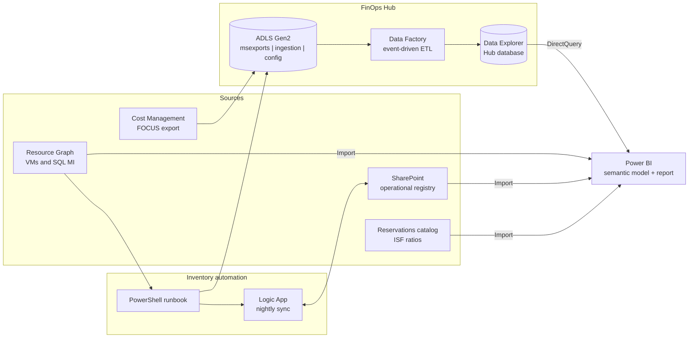
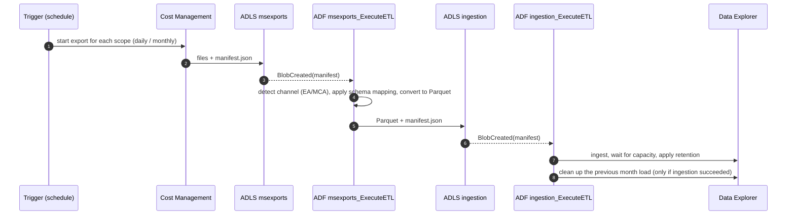
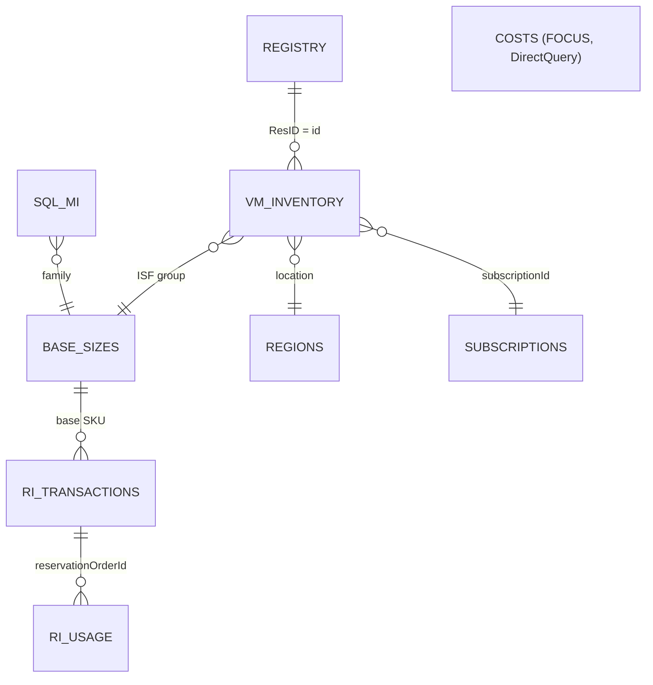
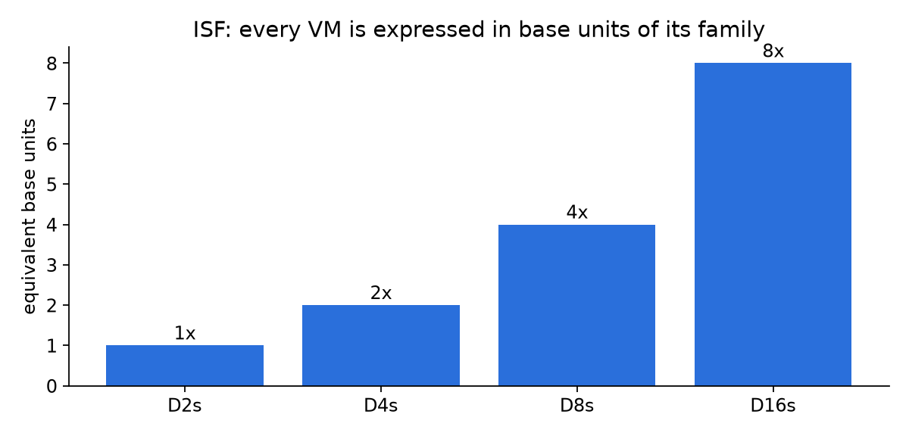
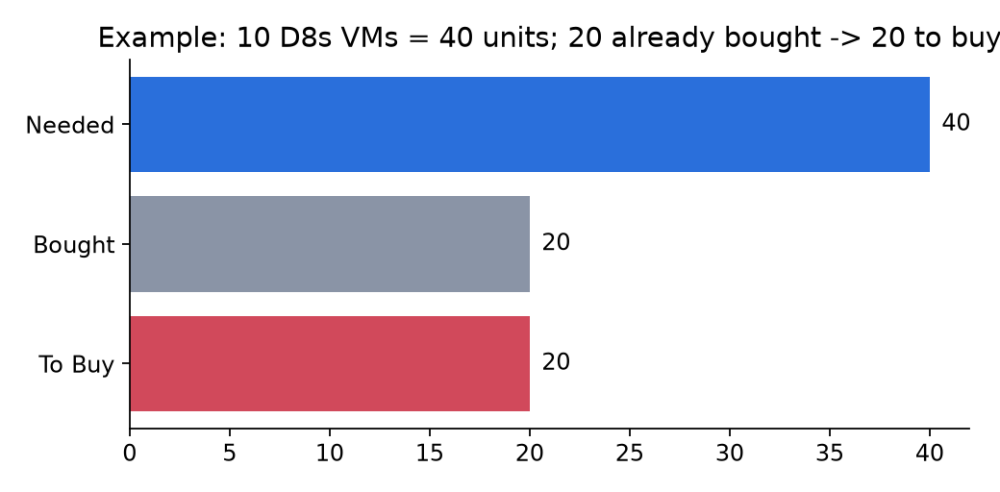
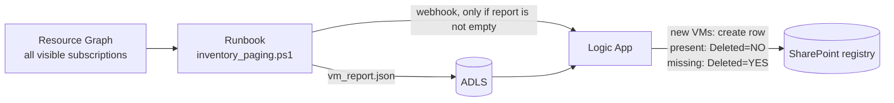
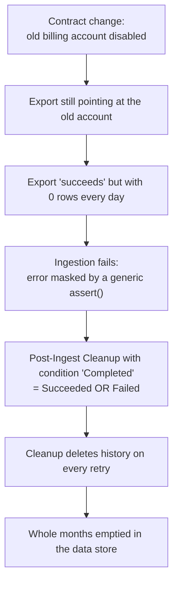
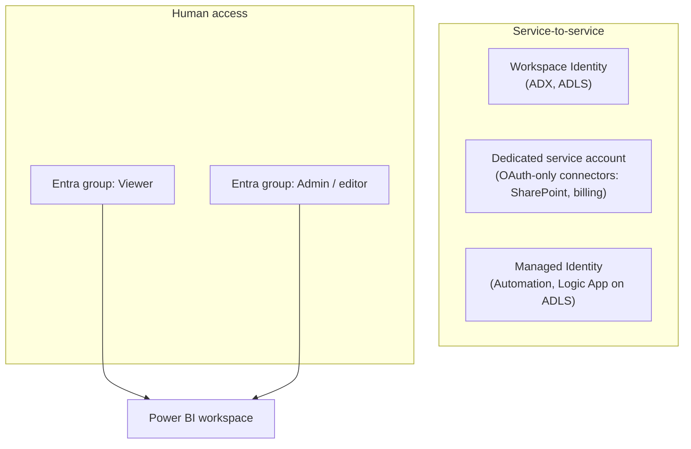

# FinOps Hub: a data platform for Azure cost governance

> Case study of a **cloud-native Azure cost analytics platform** built on the
> [Microsoft FinOps Toolkit](https://microsoft.github.io/finops-toolkit/hubs), with a recommendation engine for
> **Reserved Instances (RI) and Savings Plans (SP)**. Role: **Data / Cloud Engineer**.
> This repository describes **what was rebuilt and how**. Code and numbers are rewritten in generic form
> (no reference to the customer, tenants or real resources).


-F2C811)


## At a glance

| | |
|---|---|
| **Problem** | Cloud costs were not governed: RI/SP purchases were decided from manual spreadsheets, the VM inventory was incomplete, and pipelines broke without anyone noticing |
| **Goal** | A single reliable data foundation, a repeatable calculation of *how much to buy*, and a platform that does not depend on one person |
| **My scope** | Ingestion and ETL, analytics store, semantic model, inventory automation, data quality, identity and access, production incident diagnosis |
| **Scale** | Millions of cost records over more than a year, hundreds of VMs, 9 subscriptions, 5 event-driven triggers |
| **Stack** | Azure Cost Management, Data Factory, ADLS Gen2, Data Explorer (Kusto/KQL), Resource Graph, Logic Apps, Automation (PowerShell), Power BI (DAX, Power Query M, TMDL), Entra ID, SharePoint Online |

## Contents

1. [Problem and goal](#1-problem-and-goal)
2. [Architecture](#2-architecture)
3. [Event-driven ingestion pipeline](#3-event-driven-ingestion-pipeline)
4. [Data model and recommendation engine](#4-data-model-and-recommendation-engine)
5. [VM inventory: from a manual list to an automated sync](#5-vm-inventory-from-a-manual-list-to-an-automated-sync)
6. [Incident: five weeks of silently lost data](#6-incident-five-weeks-of-silently-lost-data)
7. [Data quality and independent validation](#7-data-quality-and-independent-validation)
8. [Identity and least privilege](#8-identity-and-least-privilege)
9. [BI as code](#9-bi-as-code)
10. [Decisions and trade-offs](#10-decisions-and-trade-offs)
11. [What I would do next (roadmap)](#11-what-i-would-do-next-roadmap)
12. [Skills demonstrated](#12-skills-demonstrated)
13. [Repository structure](#13-repository-structure)
14. [Sources and references](#14-sources-and-references)

---

## 1. Problem and goal

The report had to answer three business questions:

1. **What are we running?** A live inventory of VMs and SQL Managed Instances, enriched with owner and role.
2. **Are our reservations used well?** Utilization of the RIs and SPs already purchased.
3. **What should we buy?** How many RIs per family are still needed to cover the fleet.

Everything else (transformations, relationships, DAX columns) exists to compute these three answers correctly and verifiably.

| Before | After |
|---|---|
| Costs read from the portal, no unified history | Data in the **FOCUS** standard format in a data lake and an analytics engine |
| VM inventory maintained by hand | Inventory from Resource Graph, synced nightly with the operational registry |
| Purchases decided by eye | Normalized (ISF), reproducible calculation, validated by an independent script |
| Pipelines failing silently | Freshness checks, guard-rails and a data quality scorecard |
| Refresh tied to one person's account | Service identities and groups, no personal dependency |

---

## 2. Architecture

Guiding choice: **reuse the open standard** (FinOps Toolkit and FOCUS) instead of building a proprietary format,
and add on top what the toolkit does not provide: inventory, recommendations, data quality, access control.



Two distinct data paths:

| Path | Data | Mode | Why |
|---|---|---|---|
| **A: costs** | Cost Management export → ADLS → ADF → Data Explorer | **DirectQuery** | High volume, always as fresh as the last run, no copy inside Power BI |
| **B: operational** | Inventory, registry, RIs, lookups | **Import** | Small volumes, fast joins and DAX calculations |

---

## 3. Event-driven ingestion pipeline

Each step is triggered by the previous one through the **creation of a `manifest.json`**: no fixed schedule to
synchronize, no central orchestrator to maintain.



Five triggers: two **schedules** (daily and monthly) and three **blob events** (configuration changed, raw manifest,
processed manifest). The choices that matter:

- **Per-month idempotency.** Exports are *month-to-date*: every run contains the current month again. The cleanup
  removes the previous version of the month after ingestion, otherwise costs would be counted twice.
- **FOCUS standard.** Schema mapping converts native formats into FOCUS: the same columns (`BilledCost`, `EffectiveCost`,
  `ContractedCost`, `CommitmentDiscount*`) regardless of contract type.
- **Parquet + Snappy** as the intermediate format: columnar, compressed, well suited to Data Explorer.

The code for the most important pipeline fix is in [`code/adf/post_ingest_cleanup.json`](code/adf/post_ingest_cleanup.json) (see [§6](#6-incident-five-weeks-of-silently-lost-data)).

---

## 4. Data model and recommendation engine

A hybrid semantic model (DirectQuery for costs, Import for the rest), versioned as code.



### The ISF normalization chain

A reservation does not cover *one* VM size: it covers a **family**, proportionally (Instance Size Flexibility).
To know how many RIs are needed, every VM must be converted into a **common unit**: how many VMs of the family's
smallest size it is equivalent to.



```text
vmSize  = Standard_D8s_v5
  -> ISF lookup:        Ratio = 4, group = "DSv5"
  -> smallest size in the group: D2s_v5, MinRatio = 1
RatioDivided = Ratio / MinRatio = 4        # this VM is worth 4 base units
Needed  = SUM(RatioDivided) over the eligible fleet
To Buy  = Needed - SUM(RIs already purchased)
```



The full code (calculated columns, base-size table, purchasing round summary) is in
[`code/dax/ri_calculation_chain.dax`](code/dax/ri_calculation_chain.dax). Excerpt:

```dax
RatioDivided = DIVIDE(VmInventory[Ratio], VmInventory[MinRatio])

RI_Round_Summary =
VAR Combos = CROSSJOIN(VALUES(BaseSizes[MinVMSize]), VALUES(Regions[Regions]))
RETURN
ADDCOLUMNS(Combos,
    "Needed", CALCULATE(SUM(VmInventory[RatioDivided]),
                  Registry[AO] = "TRUE", Registry[Deleted] <> "YES",
                  Registry[Keep] IN {"Permanent", "AVD"}),
    "Needed (All Fleet)", CALCULATE(SUM(VmInventory[RatioDivided])),
    "Bought", CALCULATE(SUM(RiTransactions[quantity])),
    "To Buy", [Needed] - [Bought])
```

Modeling decisions worth noting:

- **Two need measures**: `Needed` (eligible VMs only, per business rule) and `Needed (All Fleet)`. The gap stays visible
  instead of vanishing behind a filter.
- **SKUs with no ISF match** have a blank `RatioDivided` and `SUM` ignores them. This is intentional and documented:
  that is why an ISF coverage check exists ([§7](#7-data-quality-and-independent-validation)).
- **Manual row for SQL Managed Instance**: it is not in the ISF file, but the relationship needs it to work.
- **Savings Plans**: coverage = `SP Used / (SP Used + VM On-Demand)`. Theoretical savings use the **empirical average
  discount** of Savings Plans already in use, per region and subscription, not an invented value
  ([`code/dax/savings_plan_and_dq_measures.dax`](code/dax/savings_plan_and_dq_measures.dax)).
- **Stable ISF source.** The public CSV that fed the ratios was retired: the migration is to the **Reservations Catalog
  API**, where the group and ratio live in `skuProperties`. Legacy SKUs no longer purchasable as RIs
  stay out of the calculation and should be evaluated as Savings Plans instead.

---

## 5. VM inventory: from a manual list to an automated sync

The operational registry (owner, role, "keep") is curated by hand in SharePoint. A nightly chain keeps it aligned
with the reality of Azure.



The defects found and fixed, all **silent** (no visible error, just wrong data):

| Symptom | Root cause | Fix |
|---|---|---|
| Whole VM families marked "deleted" | The Managed Identity lacked `Reader` on one subscription: `Get-AzSubscription` could not see it | Role assignment and a coverage check |
| Duplicate rows in the registry | 4 parallel `Foreach` loops wrote to the same array variable (race condition) | `concurrency.repetitions = 1` |
| Exceptions on records without a ResID | `trim(null)` | `coalesce(..., '')` in every comparison |
| VMs present but marked "deleted" | Comparison used `toLower` but not `trim` | Same pattern on both sides |
| "Ghost" deletion date after a restore | The update did not clear `DeletionDate` | `"DeletionDate": null` in the patch |
| **Empty report** that would have marked everything as deleted | `Search-AzGraph -Skip 0` is invalid: warning, job "Completed", empty file overwrote the good one | `-Skip 1` and a **guard-rail**: empty report ⇒ abort |

```powershell
if ($all.Count -eq 0) { throw "Empty inventory: aborting, the last valid report is not overwritten." }
```

Code: [`code/automation/inventory_paging.ps1`](code/automation/inventory_paging.ps1) and the Logic App expressions in
[`code/automation/logicapp_expressions.md`](code/automation/logicapp_expressions.md).

> **Lesson**: a job with status "Completed" is not a correct job. Automations that write to a downstream system
> must reject empty or implausible input.

---

## 6. Incident: five weeks of silently lost data

The cost report had been stale for over a month. No alert had fired.



**Two independent defects that compounded:**

1. **Export scope** left on the old billing account after the contract migration: it produced empty files without errors.
2. **Wrong dependency in the cleanup**: the "Post-Ingest Cleanup" activity depended on "Ingest Data" with condition
   `Completed` (which includes failure) instead of `Succeeded`. Every failed ingestion deleted historical data
   "because it will be replaced anyway", but nothing ever replaced it.


*Illustrative chart on a relative scale (100 = healthy month).*

**Diagnosis.** The real error was hidden behind an `assert()` in the ingestion activity. To see it I ran the same logic in an
**ad hoc ADF debug pipeline**, bypassing the masked error handling, and cross-checked the result with
per-month counts in KQL ([`code/kusto/health_checks.kql`](code/kusto/health_checks.kql)).

**Fix:**

```json
{
  "name": "Post-Ingest Cleanup",
  "type": "AzureDataExplorerCommand",
  "dependsOn": [
    { "activity": "Ingest Data", "dependencyConditions": [ "Succeeded" ] }
  ]
}
```

**Recovery.** The pipeline backfill proved unreliable (it reported "Succeeded" without starting real exports): I used the portal's
historical export and verified the result on three levels (export history → ADF Monitor → per-month counts in ADX).

**What I changed to prevent a repeat**

- `Succeeded` dependency conditions on every destructive step.
- Freshness checks (`DQ Last Cost Date`, rows per month) as part of the report.
- An audit of the other assets tied to the same billing account.

---

## 7. Data quality and independent validation

Two complementary levels.

**1. In-report scorecard** ([`code/dax/savings_plan_and_dq_measures.dax`](code/dax/savings_plan_and_dq_measures.dax)):
registry VMs with no counterpart in Azure (stale), Azure VMs missing from the registry, reservations without usage
data, latest cost date available. Checked before every purchasing round.

**2. Independent recomputation outside Power BI** ([`code/python/validate_ri_needed.py`](code/python/validate_ri_needed.py)).
The script replicates the model's logic from three CSV files so the totals can be compared.

```bash
python code/python/validate_ri_needed.py \
  --vms code/python/sample/vms.csv \
  --isf code/python/sample/isf.csv \
  --registry code/python/sample/registry.csv
```

```text
      MinVMSize   location  needed_eligible  needed_all_fleet
Standard_D2s_v5 westeurope              6.0               7.0

VMs with no ISF match: 1
```

Details that needed care, because they are where the two calculations diverge:

- **Resource ID casing**: Azure returns the same ID with different capitalization; the join must be lower-cased on both sides.
- **Boolean types**: a Yes/No field can arrive as `TRUE`, `True`, `1` or a native boolean depending on the export.
- **Deterministic tie-break** for the group's smallest size (alphabetical order on equal ratio).
- **Engine artifacts**: `VALUES()` on a column in a relationship includes a virtual blank row. It was not a missing VM,
  and a direct filter proved it.

Validation outcomes worth citing: the gap between portal and model SP figures was within 2% (period and rounding
differences), and an apparent anomaly on one reservation order was structural API behavior (capacity products have no
utilization summary).

---

## 8. Identity and least privilege

Goal: **the backend must keep working even if one person's account is deleted.**



- **Managed identities** wherever the connector allows it; a **non-personal service account** where only OAuth exists.
- **Groups, never direct users**: adding or removing a person is the only maintenance.
- **Least privilege re-evaluated before rollout**: start broad to unblock, then reset the permissions and reassign only what is proven necessary.
- Expiring credentials (service account password, service principal secret) are **documented as a repeatable procedure**, not as one person's knowledge.
- An instructive case: a permission at billing-account level does **not** cover data at billing-profile level; the error (403 then 400) required understanding
  which scope each endpoint supports.

---

## 9. BI as code

The semantic model and the report are in **PBIP/TMDL** format: text files, versionable and diffable.

- Every change (DAX measures, Power Query M queries, pages) is a readable commit, not an opaque binary.
- The same repository syncs with the development machine, no manual file copies.
- You can review, `git diff` and roll back a single measure.

Domain note: in the model, Service and Desktop parameters are **separate**. A parameter changed in Desktop and republished
is not enough: it must also be set in the dataset settings in the Service.

---

## 10. Decisions and trade-offs

| Decision | Alternative | Why |
|---|---|---|
| Reuse FinOps Toolkit and FOCUS | Proprietary pipeline | Open standard, community updates, less code to maintain |
| DirectQuery on costs, Import on the rest | All Import | Cost volume and freshness; small data served fast from memory |
| Data Explorer as analytics store | Just ADLS + Power BI | Aggregations over millions of rows and ad hoc KQL (with a non-trivial fixed cost: it must be evaluated) |
| Public networking, RBAC and managed identities | Private endpoints everywhere | Conscious cost and simplicity choice for a non-sensitive internal workload |
| Nightly sync with a Logic App | Real-time, event-driven | The registry changes slowly; sequential execution (16 min) eliminated the race condition |
| Separate Python validator | Trusting DAX alone | Two independent implementations that agree are worth more than one |
| Low-code Logic App | Code | It was the existing component: I stabilized it. It is the component with the most bugs in the whole project |

Open trade-offs, stated openly: dependency on a billing connector being deprecated, a service account with periodic expiry,
and a need calculated on an ISF source that is being migrated.

---

## 11. What I would do next (roadmap)

These points are **not yet applied** to the project: they are the plan to move it from "well documented" to "reproducible".

1. **Infrastructure as Code (Terraform).** Today environments are configured from the portal. First step: model the data lake storage as a
   module and import it with `terraform import` until `terraform plan` shows no differences
   ([`code/terraform/main.tf`](code/terraform/main.tf), already written as an experiment). Then RBAC roles, the Data Explorer cluster and the Data Factory shell;
   pipelines stay in ADF's native git mode.
2. **CI/CD with automated tests.** Run the Python validator and the health check queries in a pipeline as *gates*, instead of a reactive scorecard.
3. **Code-first orchestration.** Rewrite the registry sync as testable code (e.g. Airflow calling ADF) to remove the class of Logic App bugs.
4. **Proactive alerts** on rows per month and on "export with zero rows".
5. **Key Vault + Managed Identity** instead of secrets with manual expiry.

---

## 12. Skills demonstrated

| Area | Evidence |
|---|---|
| **ETL / orchestration** | Event-driven ADF pipelines with manifests, schema mapping, per-month idempotency |
| **Data modeling** | Hybrid semantic model, ISF, relationships, advanced DAX and Power Query M |
| **Analytics store** | KQL, ingestion, retention, diagnosis of ingestion errors |
| **Data quality** | Scorecard, independent validator, explicit eligibility rules |
| **Automation** | PowerShell runbooks, Logic Apps, guard-rails and idempotency |
| **Incident response** | Root cause analysis across a distributed multi-service system; verified data recovery |
| **Security** | Managed identities, group-based RBAC, least privilege, credential rotation |
| **Engineering** | BI as code (TMDL/Git), handover documentation |
| **FinOps** | FOCUS standard, RI/SP, coverage and utilization, empirical discounts |

---

## 13. Repository structure

```text
.
├── README.md
├── assets/                       # charts (regenerable with make_charts.py)
└── code/
    ├── adf/post_ingest_cleanup.json
    ├── automation/               # PowerShell runbook and Logic App expressions
    ├── dax/                      # ISF chain, Savings Plans, data quality
    ├── kusto/health_checks.kql
    ├── python/                   # independent validator + sample data
    └── terraform/main.tf         # IaC roadmap (experimental)
```

The incident and purchase-example charts are **illustrative**. The code was rewritten in generic form
and the only runnable script, the validator, was tested on the included sample data.

---

## 14. Sources and references

- [FinOps hubs overview, Microsoft Learn](https://learn.microsoft.com/cloud-computing/finops/toolkit/hubs/finops-hubs-overview): Cost Management → ADLS → Data Factory → Data Explorer/Fabric architecture
- [FinOps hubs data processing](https://learn.microsoft.com/cloud-computing/finops/toolkit/hubs/data-processing) and [data model](https://learn.microsoft.com/cloud-computing/finops/toolkit/hubs/data-model)
- [FinOps Toolkit](https://microsoft.github.io/finops-toolkit/hubs) (open source repository)
- [FOCUS, the FinOps Open Cost and Usage Specification](https://focus.finops.org/what-is-focus/) and [the spec on Microsoft Learn](https://learn.microsoft.com/en-us/cloud-computing/finops/focus/what-is-focus)
- [Instance size flexibility, Azure Reservations](https://learn.microsoft.com/en-gb/azure/cost-management-billing/reservations/instance-size-flexibility) and [VM size flexibility](https://learn.microsoft.com/en-my/azure/virtual-machines/reserved-vm-instance-size-flexibility)
- [How to structure a data engineer portfolio](https://dataengineeracademy.com/blog/how-to-build-a-data-engineering-portfolio-from-scratch/): diagram up front, stack, flow, tests, limits and trade-offs (informal source, not a standard)

> The numbers and diagrams in this repository are generic: names, identifiers, amounts and people from the real project were removed on purpose.
