# Azure Data Platform: Legacy-to-Cloud Re-platforming

> Case study di un progetto di **re-platforming** di un gestionale desktop (client Windows + SQL Server on-prem)
> verso una **piattaforma web multi-azienda su Azure**. Ruolo: **Data / Cloud Engineer**.
> Il repository descrive **cosa è stato rifatto e come**, con diagrammi e codice di esempio scritto da zero in forma generica.


## In sintesi

| | |
|---|---|
| **Problema** | Applicazione desktop con logica nel client e nel database, accessi diretti al DB, nessun isolamento tra le società che condividono i dati |
| **Obiettivo** | Portare il sistema sul web, multi-azienda, sicuro, rilasciabile in modo ripetibile |
| **Mia area** | Modello dati, migrazione, database-as-code, infrastruttura come codice, pipeline CI/CD, sicurezza dei dati, test su DB reale |
| **Scala** | Oltre un centinaio di tabelle, multi-tenant, più moduli funzionali, 3 ambienti (Dev, UAT, Production) |
| **Stack** | Azure SQL, Cosmos DB, Blob Storage, Service Bus, Functions, AI Search, App Gateway + WAF, Bicep, GitHub Actions, .NET 10, React |

## Indice

1. [Dal sistema legacy al target](#1-dal-sistema-legacy-al-target)
2. [Architettura](#2-architettura)
3. [Database as code](#3-database-as-code)
4. [Multi-tenancy nel modello dati](#4-multi-tenancy-nel-modello-dati)
5. [Governance della migrazione dati](#5-governance-della-migrazione-dati)
6. [Dati di sviluppo ripetibili e reversibili](#6-dati-di-sviluppo-ripetibili-e-reversibili)
7. [Confini dei moduli verificati dai test](#7-confini-dei-moduli-verificati-dai-test)
8. [Pipeline CI/CD](#8-pipeline-cicd)
9. [Sicurezza: identità e privilegio minimo](#9-sicurezza-identità-e-privilegio-minimo)
10. [Test su database effimero](#10-test-su-database-effimero)
11. [Ricerca come proiezione derivata](#11-ricerca-come-proiezione-derivata)
12. [Decisioni e compromessi](#12-decisioni-e-compromessi)
13. [Competenze dimostrate](#13-competenze-dimostrate)
14. [Fonti e riferimenti](#14-fonti-e-riferimenti)

---

## 1. Dal sistema legacy al target

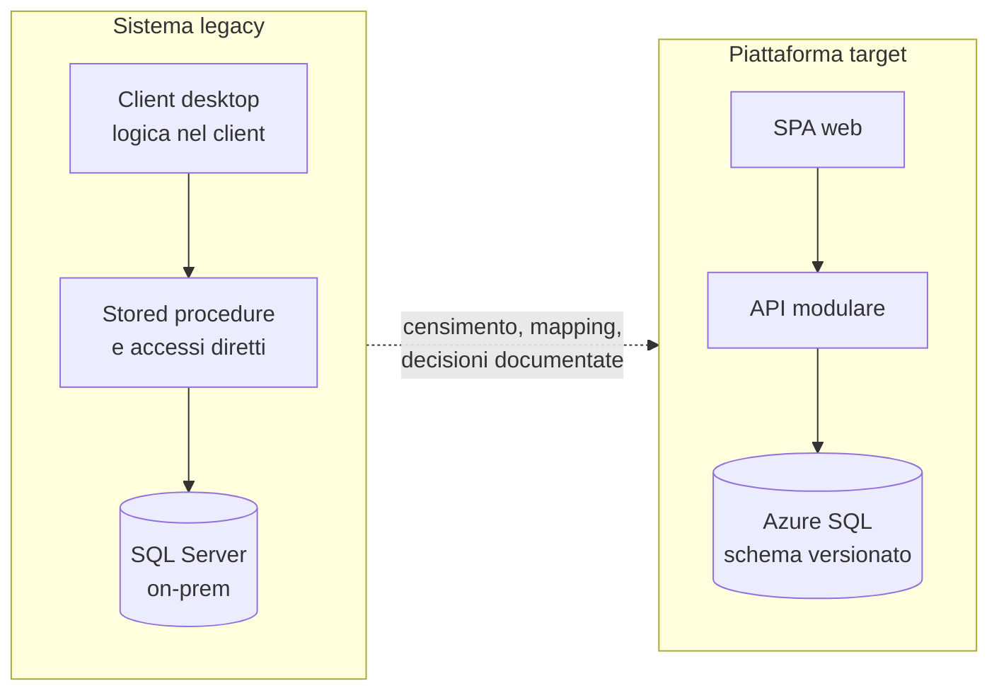

Il lavoro non è stato una conversione 1:1. Per ogni tabella è stato deciso **se, come e quando** importarla, e
cosa fare quando la decisione dipende da qualcuno che non l'ha ancora presa (vedi [§5](#5-governance-della-migrazione-dati)).

Cosa è cambiato rispetto al legacy:

| Prima | Dopo |
|---|---|
| Logica di business nel client e nel DB | Moduli applicativi con contratti espliciti |
| Schema modificato a mano | Schema dichiarato nel codice, distribuito come DACPAC |
| Credenziali SQL | Managed Identity, nessuna password |
| Un'unica base dati senza scope | Ogni riga appartiene a un'azienda, con integrità garantita dal modello |
| Rilascio manuale | Candidato immutabile promosso tra ambienti |

---

## 2. Architettura

Scelta guida: **monolite modulare**, non microservizi. I moduli condividono ciclo di rilascio e database
transazionale ma hanno confini espliciti; si estrae un servizio solo quando carico, isolamento o autonomia di
rilascio lo giustificano.

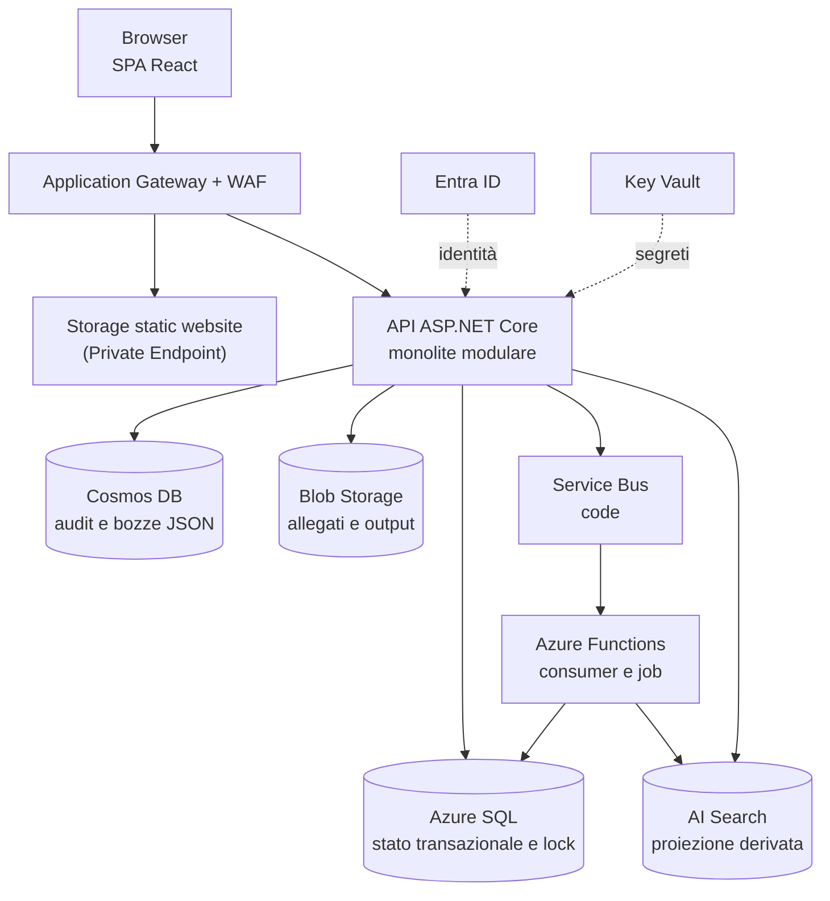

Ruolo di ciascun datastore:

| Datastore | Contiene | Perché |
|---|---|---|
| **Azure SQL** | Stato transazionale, lock autorevoli | Integrità relazionale, vincoli, transazioni |
| **Cosmos DB** | Audit append-only e bozze JSON, partizionati per azienda | Documenti a schema flessibile, scritture ad alto volume |
| **Blob Storage** | Allegati e output generati | File non strutturati |
| **AI Search** | Proiezione di ricerca | Full-text e ranking, ricostruibile dalla fonte |

Regola: **Cosmos non sostituisce SQL** per stato transazionale e lock. Audit e bozze passano da repository
applicativi indipendenti dall'SDK, così il datastore resta sostituibile.

---

## 3. Database as code

Lo schema non è mai modificato a mano né dall'applicazione all'avvio. È dichiarato in un progetto SQL SDK-style,
compilato in un **DACPAC** versionato insieme alla release.

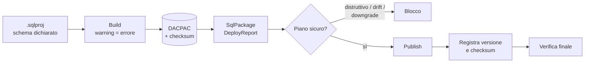

Principi applicati:

- **Forward-only.** Nessuno script `Down`: il ripristino è backup o Point-in-Time Restore.
- **Expand / migrate / contract** per le modifiche incompatibili, su più release, così la versione precedente
  continua a funzionare durante il rollout.
- **Script Pre/Post-Deployment idempotenti** per trasformazioni e dati di configurazione.
- **Gate automatici sul piano**: modifiche distruttive, operazioni `Alter` non classificabili, drift rispetto
  al modello registrato e downgrade bloccano il rilascio.
- **Tracciabilità**: un'extended property del database registra numero di run e checksum del DACPAC,
  scritta solo dopo la verifica.
- **Primo deploy** solo su database vuoto con un punto di ripristino disponibile.

Esempio generico di gate sul piano di deploy (illustrativo, non è il codice originale):

```powershell
# Fallisce se il DeployReport contiene operazioni non ammesse
[xml]$report = Get-Content $deployReportPath
$ops = $report.DeploymentReport.Operations.Operation

$blocked = $ops | Where-Object {
    $_.Name -in 'Drop', 'Alter' -and $_.Item.Type -in 'SqlTable','SqlColumn'
}
if ($blocked) {
    $blocked | ForEach-Object { Write-Error "Operazione non ammessa: $($_.Name) $($_.Item.Value)" }
    exit 1
}
```

> Riferimenti ufficiali su drift e DeployReport in [§14](#14-fonti-e-riferimenti).

---

## 4. Multi-tenancy nel modello dati

L'isolamento tra aziende è **nel modello**, non solo nel codice applicativo. Una tabella figlia non può
puntare a una riga di un'altra azienda perché la chiave esterna è **composta** e include l'azienda.

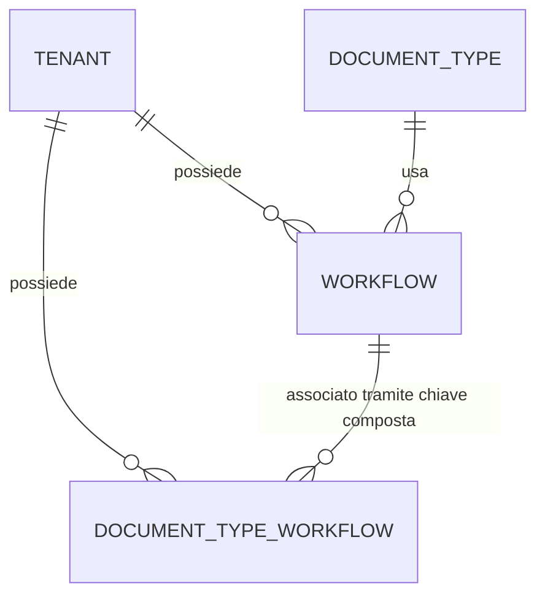

Esempio (riscritto in forma generica): associazione tra un tipo di documento e un workflow, con **un solo
predefinito per coppia**.

```sql
CREATE TABLE dbo.DocTypeWorkflow (
    Id           INT IDENTITY(1,1) NOT NULL,
    TenantId     INT         NOT NULL,
    DocTypeId    NVARCHAR(3) NOT NULL,
    WorkflowId   INT         NOT NULL,
    IsDefault    BIT         NOT NULL,
    RowVer       ROWVERSION  NOT NULL,   -- concorrenza ottimistica
    CONSTRAINT PK_DocTypeWorkflow PRIMARY KEY CLUSTERED (Id),
    CONSTRAINT FK_DTW_Tenant   FOREIGN KEY (TenantId)  REFERENCES dbo.Tenant (TenantId),
    CONSTRAINT FK_DTW_DocType  FOREIGN KEY (DocTypeId) REFERENCES dbo.DocType (DocTypeId),
    -- la chiave composta impedisce di agganciare un workflow di un'altra azienda
    CONSTRAINT FK_DTW_Workflow FOREIGN KEY (TenantId, DocTypeId, WorkflowId)
        REFERENCES dbo.Workflow (TenantId, DocTypeId, WorkflowId)
);

-- Un solo predefinito per (azienda, tipo): indice univoco filtrato
CREATE UNIQUE NONCLUSTERED INDEX UX_DTW_OneDefault
    ON dbo.DocTypeWorkflow (TenantId, DocTypeId) WHERE IsDefault = 1;
```

Due idee da portare via:

1. **Il vincolo vive nel database**, dove non si può aggirare con un bug applicativo.
2. **L'indice filtrato** esprime "al massimo uno" senza trigger. Cosa succede quando ne manca uno resta
   responsabilità del consumer applicativo, e il codice lo dichiara in un commento invece di fingere di
   garantirlo.

Ogni modifica di questo tipo è accompagnata da test di schema che leggono il file SQL e verificano
vincoli e indici, così una regressione fallisce in CI.

---

## 5. Governance della migrazione dati

Con oltre un centinaio di tabelle, il rischio non è tecnico ma di **decisioni mancanti**. Ogni tabella ha un esito esplicito,
mai tacito.

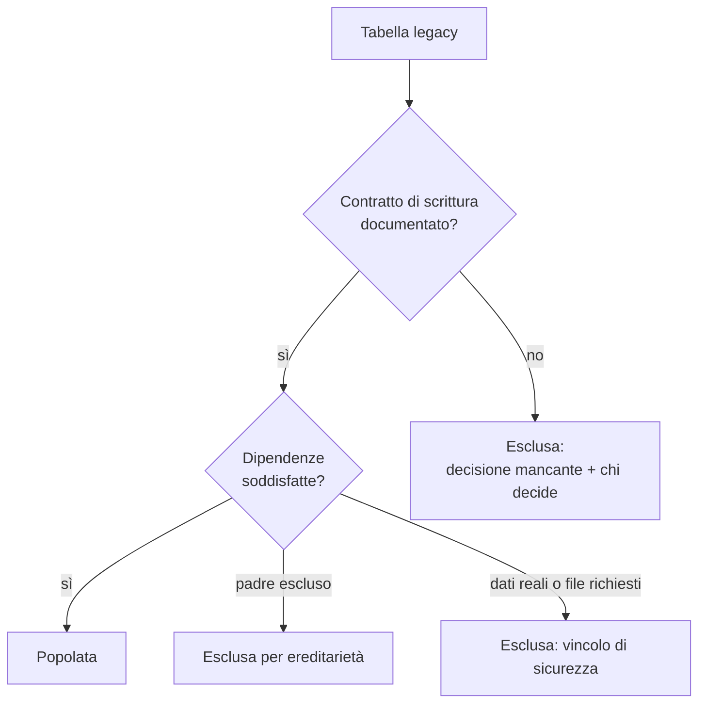

Tre pratiche che hanno funzionato:

- **Censimento dello schema** generato da script, non scritto a mano.
- **Matrice di conversione dei tipi** (centinaia di colonne): per ogni colonna tipo sorgente, destinazione, azione
  proposta e stato. Le sostituzioni tecniche non approvate (per esempio `text` → `varchar(max)`) restano marcate
  come tali finché non sono accettate.
- **Registro delle decisioni** collegato alle tabelle bloccate: ogni esclusione riporta *quale decisione la
  blocca*, *perché* e *chi deve prenderla*.

Il report di copertura è **generato** e confrontato in CI: se una tabella nuova compare nello schema senza esito, la
verifica fallisce.

```python
# Copertura esatta: ogni tabella ha un esito, nessun esito è duplicato o orfano
classificate = set(seed) | set(escluse) | set(prerequisiti)
if classificate != set(schema):
    raise ValueError(
        f"Copertura non esatta: mancanti={set(schema) - classificate}, "
        f"extra={classificate - set(schema)}"
    )
if set(seed) & set(escluse):
    raise ValueError("Una tabella non può essere sia popolata sia esclusa")

# In CI: il report versionato deve coincidere con quello rigenerato
if args.check and REPORT.read_text() != genera_report(schema, seed):
    raise ValueError("Report non allineato: rigenerare")
```

---

## 6. Dati di sviluppo ripetibili e reversibili

Il dataset demo deve poter essere applicato più volte e rimosso **senza toccare dati preesistenti**.

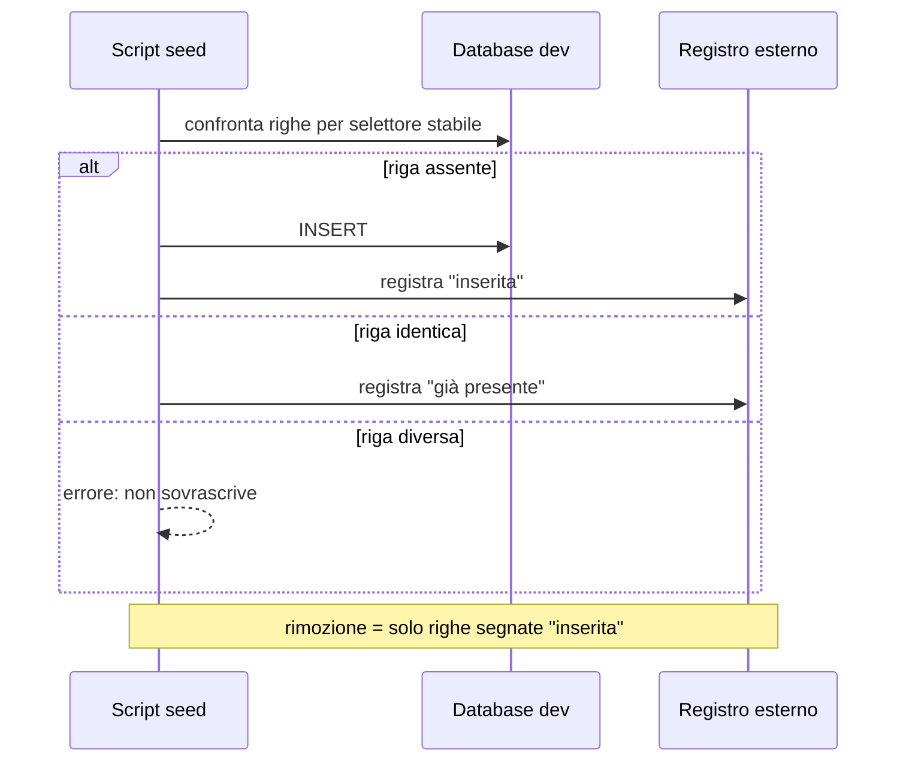

Scelte di progetto:

- **Selettore stabile** per ogni riga (chiave naturale), non l'identity generata.
- **Confronto completo** alla riesecuzione: se una riga esiste ma differisce, il seed si ferma.
- **Registro esterno** delle sole righe inserite, usato per una rimozione conservativa e transazionale.
- Marcatura esplicita `[DEMO]` e **nessun dato reale**.
- Le righe aziendali sono ripetute per ciascuna azienda, i master globali non sono duplicati.

---

## 7. Confini dei moduli verificati dai test

Un confine non verificato è un'intenzione. I riferimenti consentiti tra progetti sono una tabella nel codice,
e un test fallisce se un `.csproj` ne aggiunge uno non previsto.

```csharp
// Riscritto in forma generica
public sealed class ProjectDependencyTests
{
    private static readonly IReadOnlyDictionary<string, string[]> Allowed =
        new Dictionary<string, string[]>
        {
            ["Orders.Application"]    = ["Shared.Abstractions", "Identity.Application"],
            ["Orders.Infrastructure"] = ["Orders.Application", "Persistence"],
            ["Orders.Presentation"]   = ["Orders.Application", "Presentation.Abstractions"],
        };

    [Fact]
    public void Every_project_references_only_allowed_projects()
    {
        foreach (var (project, allowed) in Allowed)
        {
            var actual = ReadProjectReferences(project);       // legge il .csproj
            Assert.Empty(actual.Except(allowed));              // nulla fuori dalla lista
        }
    }
}
```

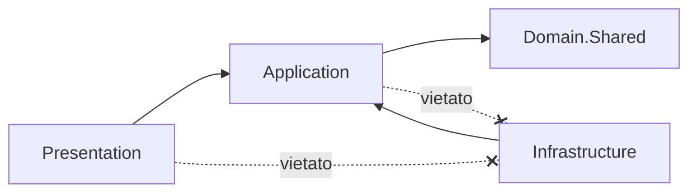

Vantaggio: un modulo non può raggiungere le strutture interne di un altro senza che la CI lo segnali.

---

## 8. Pipeline CI/CD

Due fasi distinte: la **CI produce un candidato immutabile**, la **promozione lo sposta** tra ambienti
senza ricompilarlo.

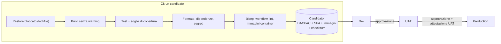

Controlli presenti:

| Area | Controllo |
|---|---|
| Riproducibilità | Restore con lockfile congelato (pnpm e NuGet in locked mode), versioni SDK fissate |
| Qualità | Build con warning come errori, formattazione, tipi strict, soglie di coverage |
| Supply chain | Audit delle dipendenze NuGet e npm, scansione delle immagini con Trivy |
| Segreti | Scansione del sorgente con Gitleaks |
| Infrastruttura | Compilazione Bicep, lint dei workflow con actionlint, test dei contratti offline |
| Release | Candidato verificato per checksum, riuso al retry, nessuna sovrascrittura di tag con contenuto diverso |

Autenticazione della pipeline **senza segreti**: federazione OIDC verso Azure, token rinnovato dopo le
operazioni lunghe.

```yaml
# Schema semplificato della promozione (illustrativo)
promote:
  environment: UAT                       # approvazione manuale
  permissions: { id-token: write, contents: read }
  steps:
    - uses: azure/login@v2               # OIDC, nessun client secret
    - run: verify-candidate --run ${{ inputs.source_run_id }}   # checksum e attestazioni
    - run: deploy-infrastructure --what-if-first                # plan + apply
    - run: sqlpackage /Action:DeployReport ...                  # piano, poi gate
    - run: sqlpackage /Action:Publish ...                       # solo se il piano è ammesso
    - run: promote-candidate --no-rebuild                       # stessi byte della CI
```

**Idempotenza della CI**: se un candidato completo è già pubblicato viene verificato e riusato; se la
pubblicazione era parziale si verificano i tag esistenti prima di pubblicare quelli mancanti.

---

## 9. Sicurezza: identità e privilegio minimo

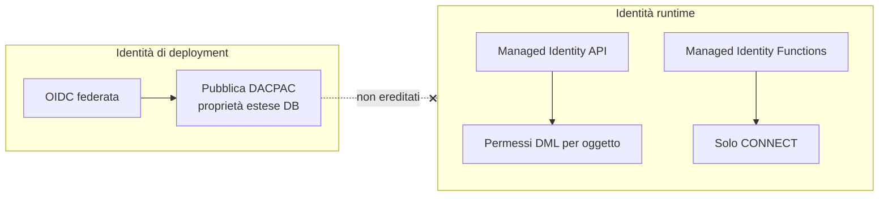

Principi:

1. **Nessuna password**: connessioni con Managed Identity e TLS verificato.
2. **Identità separate**: chi distribuisce lo schema non è chi lo usa a runtime. I permessi di deployment non
   passano al workload.
3. **Contratto dei grant versionato**: un file elenca, per oggetto, se il runtime ha sola lettura, lettura e
   aggiornamento o lettura e scrittura. Nessun ruolo amministrativo, nessun accesso automatico a nuove tabelle.
4. **Verifica negativa**: un workflow controlla non solo che i permessi previsti esistano, ma che quelli non
   previsti siano assenti, e che non ci sia drift di sicurezza.
5. **Rete privata**: Private Endpoint e regole NSG per sottorete verso i soli datastore necessari (HTTPS per
   Blob/Cosmos/Search, 1433 per SQL).

```jsonc
// Contratto dei grant (forma generica)
{
  "runtimeRole": "AppRuntime",
  "readOnly":   ["Tenant", "DocType", "Workflow"],
  "readUpdate": ["OrderLine", "Resource"],
  "readWrite":  ["Customer", "Contact", "Catalog"]
}
```

Questo contratto va riesaminato ogni volta che cambiano le operazioni SQL del runtime: è un artefatto di
progetto, non una configurazione dimenticata.

---

## 10. Test su database effimero

I test che toccano SQL non usano database condivisi. Un runner dedicato:

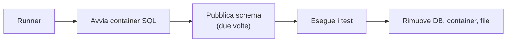

- Compila il DACPAC dagli **stessi sorgenti** del target Azure.
- Produce DeployReport e script **prima** del publish.
- **Applica lo schema due volte** per dimostrare l'idempotenza.
- Pulisce sempre, anche in caso di errore.
- Non usa `EnsureCreated` né migration dell'ORM: si testa lo schema che andrà davvero in produzione.

---

## 11. Ricerca come proiezione derivata

La ricerca globale usa **AI Search**, ma l'indice non è una fonte di verità.

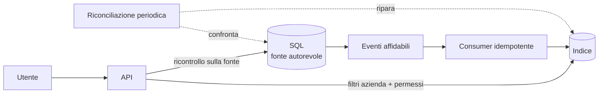

- Indice **derivato e ricostruibile**, con proiezioni su una allowlist di campi.
- **Fail closed**: se un risultato non è verificabile contro la fonte autorevole, non viene restituito.
- Un fallimento di indicizzazione **non annulla la transazione** e non viene presentato come successo.
- Riconciliazione periodica per recuperare eventi persi e rimuovere risultati obsoleti.
- Nessun embedding o RAG: la scelta è stata ridurre la superficie di rischio.

---

## 12. Decisioni e compromessi

| Decisione | Alternativa scartata | Motivo |
|---|---|---|
| Monolite modulare | Microservizi | Meno complessità distribuita; confini già imposti dai test |
| DACPAC + SqlPackage | ORM migrations | Lo schema è un artefatto di release con piano ispezionabile |
| Forward-only | Script `Down` | Il rollback reale dei dati è un ripristino, non uno script |
| Cosmos con throughput condiviso | Serverless | Serverless non disponibile nella regione scelta; costo minimo noto |
| Candidato immutabile | Rebuild per ambiente | Ciò che è provato in UAT è ciò che va in produzione |
| Esclusione esplicita delle tabelle | Seed "best effort" | Un dato inventato è peggio di un dato assente |

Cosa ho imparato:

- Il lavoro più costoso non era scrivere codice ma **rendere esplicite le decisioni mancanti** e dire chi deve prenderle.
- I **test di schema che leggono il SQL** costano poco e prevengono regressioni silenziose sui vincoli.
- Un gate che blocca è utile solo se il messaggio dice **cosa fare dopo**.

---

## 13. Competenze dimostrate

| Area | Evidenza |
|---|---|
| **Data modeling** | Chiavi composte per isolamento, indici filtrati, concorrenza ottimistica |
| **Data migration** | Censimento, matrice di conversione tipi, registro decisioni, copertura verificata in CI |
| **Database DevOps** | DACPAC, DeployReport, drift gate, forward-only, expand/contract |
| **Cloud / IaC** | Bicep modulare, reti private, Private Endpoint, NSG, Application Gateway + WAF |
| **CI/CD** | Candidato immutabile, OIDC senza segreti, promozione per ambiente, riesecuzione idempotente |
| **Sicurezza** | Managed Identity, privilegio minimo per oggetto, verifica dei permessi negativi |
| **Data stores** | Scelta motivata tra SQL, Cosmos, Blob, Search |
| **Qualità** | Test su DB effimero, architecture test, soglie di coverage, scansione segreti e immagini |

---

## 14. Fonti e riferimenti

Pratiche per costruire un repository di portfolio:

- [How to Build a Data Engineering Portfolio That Gets Interviews](https://dataengineeracademy.com/blog/how-to-build-a-data-engineering-portfolio-that-gets-interviews-5-project-types-recruiters-understand/)
- [Checklist: building a cloud data engineer portfolio](https://www.dataexpert.io/blog/checklist-building-cloud-data-engineer-portfolio)
- [The Data Engineer's GitHub Portfolio (2026 Edition)](https://pipeline2insights.substack.com/p/how-to-create-data-engineering-data-engineers-github-portfolio-in-2026)

Database DevOps su Azure SQL:

- [Detect and resolve schema drift (Microsoft Learn)](https://learn.microsoft.com/en-us/training/modules/implement-cicd-sql-database-projects/05-detect-resolve-schema-drift)
- [SqlPackage DriftReport (Microsoft Learn)](https://learn.microsoft.com/sql/tools/sqlpackage/sqlpackage-deploy-drift-report)
- [Implement CI/CD by using SQL Database Projects (Microsoft Learn)](https://learn.microsoft.com/en-us/training/modules/implement-cicd-sql-database-projects)

Confini dei moduli:

- [Make Bad Architecture Fail the Build (architecture testing in .NET)](https://www.dotnet-guide.com/tutorials/software-architecture/architecture-testing-dotnet/)

Diagrammi:

- Tutti i grafici di questo repository sono scritti in [Mermaid](https://mermaid.js.org/), renderizzato nativamente da GitHub.

> Le fonti sul portfolio sono blog di formazione: vanno lette come indicazioni pratiche, non come standard.
> Per expand/contract su DACPAC non ho trovato una guida Microsoft specifica: la sequenza descritta qui è
> la scelta adottata nel progetto, non una raccomandazione ufficiale.

---

## Nota

Gli esempi di codice sono illustrativi, scritti da zero per spiegare i concetti; nomi di tabelle e moduli sono generici.
